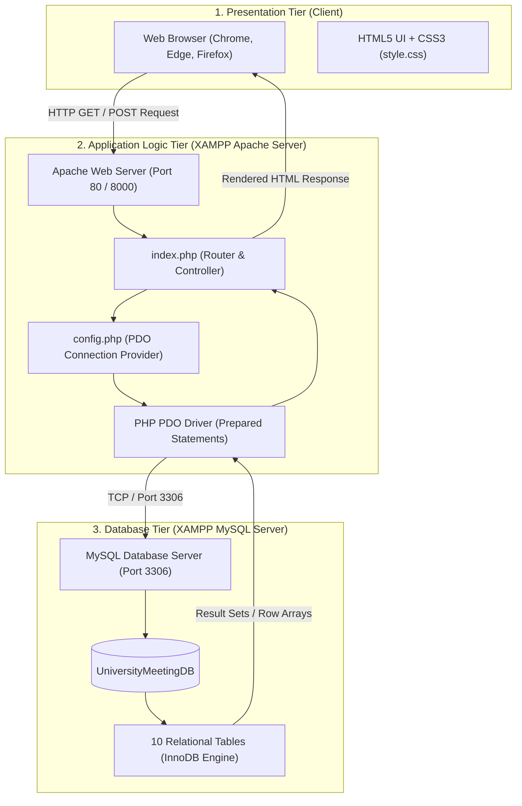
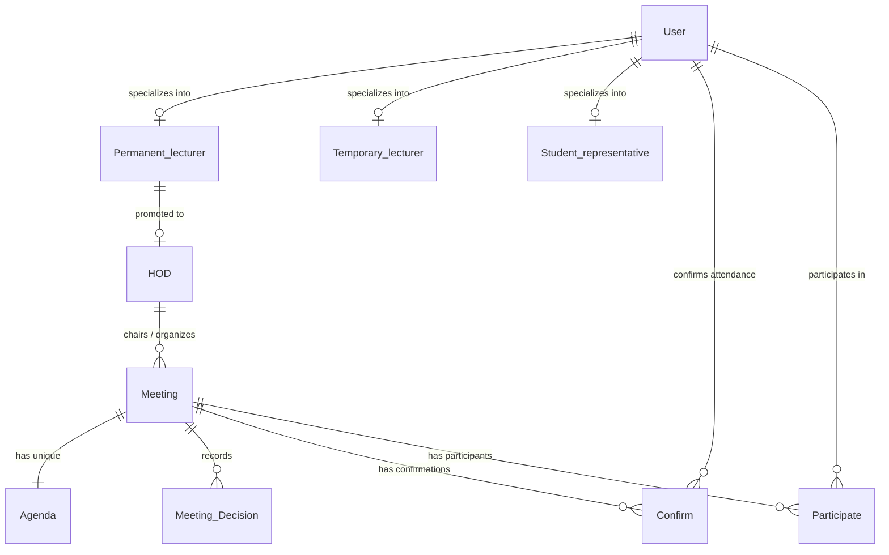

# Department Communication Management System
## Complete Student Setup, Architecture & Implementation Guide

This guide is designed for beginners. It provides a complete, step-by-step walkthrough to set up, understand, and run the **Department Communication Management System** on a local computer using **HTML, CSS, PHP, and XAMPP (Apache + MySQL)**.

---

## 📑 Table of Contents
1. [Project Overview & Learning Objectives](#1-project-overview--learning-objectives)
2. [Application Architecture](#2-application-architecture)
3. [File Structure & Code Explanation](#3-file-structure--code-explanation)
4. [Database Design & Schema Overview](#4-database-design--schema-overview)
5. [Prerequisites & Tools Installation](#5-prerequisites--tools-installation)
6. [Step-by-Step Setup Guide](#6-step-by-step-setup-guide)
7. [Testing the Application Features](#7-testing-the-application-features)
8. [Troubleshooting & FAQs](#8-troubleshooting--faqs)

---

## 1. Project Overview & Learning Objectives

The **Department Communication Management System** is a lightweight web application designed for university departments to organize meetings, agendas, meeting decisions, and attendance tracking.

### Primary Learning Objectives:
- **Database System Design**: Implement real-world relational database concepts, including:
  - Specialization / Generalization hierarchies (`User` $\rightarrow$ `Permanent_lecturer` / `Temporary_lecturer` / `Student_representative`).
  - Strict Foreign Key integrity constraints (`ON UPDATE CASCADE ON DELETE RESTRICT`).
  - Table `CHECK` constraints (e.g. valid date ranges, status validation).
  - Composite primary keys (e.g. `(MeetingId, decision)` and `(UserId, MeetingId)`).
  - 1-to-1 relationships enforced via `UNIQUE` constraints (e.g. `MeetingId` in `Agenda`).
- **PHP Data Objects (PDO)**: Securely connect to MySQL using prepared statements to prevent SQL Injection attacks.
- **Web UI & Responsive Design**: Build a clean user interface using semantic HTML5 and vanilla CSS3 without heavy external dependencies.

---

## 2. Application Architecture

The system uses a classic **3-Tier Web Application Architecture**:



### How the Request-Response Cycle Works:
1. **User Action**: The user clicks a menu link (e.g. `index.php?page=meetings`) or submits a form (e.g. adding a meeting).
2. **Routing (`index.php`)**: PHP reads the `$_GET['page']` parameter to decide which section of the page to render.
3. **Form Processing**: If an HTTP `POST` request is received, PHP extracts the form inputs, prepares an SQL query with placeholders (`?`), and securely executes it against MySQL.
4. **Data Retrieval**: PHP executes SQL `SELECT` queries using PDO and fetches data into associative arrays.
5. **Presentation**: The fetched data is safely formatted with `htmlspecialchars()` and injected into HTML tables and cards, which are styled by `style.css`.

---

## 3. File Structure & Code Explanation

The project has a clean and minimal structure:

```text
department_communication_system/
│
├── config.php          # Database credentials & PDO connection setup
├── index.php           # Core application logic, routing, and HTML views
├── style.css           # Styling, responsive layout, colors, and typography
├── schema.sql          # Complete MySQL database creation script & sample data
└── STUDENT_GUIDE.md    # This beginner setup and architecture manual
```

### File Details:

#### 1. `config.php`
- Initializes connection variables (`$host`, `$port`, `$db`, `$user`, `$pass`).
- Creates a `PDO` instance with error handling (`ERRMODE_EXCEPTION`) and disabled prepared statement emulation for enhanced security.
- Contains an informative error display card that immediately helps diagnose connection issues if MySQL is not running.

#### 2. `index.php`
Contains the entire web application interface and logic:
- **Security Helper `e()`**: Wraps text with `htmlspecialchars()` to prevent Cross-Site Scripting (XSS).
- **Controller Logic**: Handles `POST` actions (`add_meeting`, `add_decision`, `update_confirmation`, `add_agenda`, `add_participation`).
- **Data Queries**: Executes aggregate queries (`COUNT(*)`) for the dashboard and joins (`JOIN`) to link meetings, HODs, and users.
- **Navigation Views**:
  - `dashboard`: Quick stats and upcoming meeting table.
  - `meetings`: Schedule new meetings and view all existing meetings.
  - `users`: View registered department staff and student representatives.
  - `agenda`: Link an agenda document reference to a meeting.
  - `decisions`: Record official decisions made during a meeting.
  - `attendance`: Manage attendance confirmation (`Confirmed`/`Pending`) and participation records.

#### 3. `style.css`
- Uses modern CSS Flexbox and Grid layouts.
- Fully responsive on desktop, tablet, and mobile devices.
- Uses clean CSS custom properties (variables) for consistent branding.

#### 4. `schema.sql`
- Contains database creation (`CREATE DATABASE IF NOT EXISTS UniversityMeetingDB`).
- Defines all 10 relational tables with foreign keys and check constraints.
- Inserts rich sample data for immediate testing.

---

## 4. Database Design & Schema Overview

The database name is **`UniversityMeetingDB`**. It is built on the **InnoDB** storage engine to support transactions and foreign key constraints.

### Relational Entity Diagram:



### The 10 Tables Described:

| # | Table Name | Purpose | Key Constraints & Relationships |
|---|---|---|---|
| 1 | **`User`** | General users (Lecturers, Students, Staff) | `PRIMARY KEY (UserId)` |
| 2 | **`Student_representative`** | Subclass for student representatives | `FK` to `User(UserId)`, `CHECK (AcademicYear > 0)`, `RegNo UNIQUE` |
| 3 | **`Temporary_lecturer`** | Subclass for contract lecturers | `FK` to `User(UserId)`, `CHECK (ContractEndDate >= ContractStartDate)` |
| 4 | **`Permanent_lecturer`** | Subclass for permanent academic staff | `FK` to `User(UserId)`, `PermanentEmployeeId UNIQUE` |
| 5 | **`HOD`** | Head of Department | `FK` to `Permanent_lecturer(UserId)`, `CHECK (AppoinmentEndDate >= AppoinmentStartDate)` |
| 6 | **`Meeting`** | Department meeting records | `FK` to `HOD(UserId)` |
| 7 | **`Meeting_Decision`** | Decisions finalized in meetings | `PRIMARY KEY (MeetingId, decision)`, `FK` to `Meeting(MeetingId)` |
| 8 | **`Agenda`** | Agenda items and document references | `MeetingId UNIQUE` (1-to-1), `FK` to `Meeting` & `HOD` |
| 9 | **`Confirm`** | RSVP attendance confirmation | `PRIMARY KEY (UserId, MeetingId)`, `CHECK (Status IN ('Confirmed','Pending'))` |
| 10 | **`Participate`** | Confirmed actual participation | `PRIMARY KEY (UserId, MeetingId)`, `FK` to `User` & `Meeting` |

---

## 5. Prerequisites & Tools Installation

You only need **one tool** installed on your Windows computer: **XAMPP**.

### How to Install XAMPP:
1. Visit the official website: **[https://www.apachefriends.org/](https://www.apachefriends.org/)**
2. Download **XAMPP for Windows** (PHP 8.1, 8.2, or latest).
3. Run the installer `.exe` file.
   - When prompted to select components, ensure at least **Apache**, **MySQL**, and **phpMyAdmin** are checked.
   - Leave the install folder as default: `C:\xampp`.
4. Finish the installation and launch the **XAMPP Control Panel**.

---

## 6. Step-by-Step Setup Guide

Follow these 5 simple steps to get the project running:

### Step 1: Copy Project Folder to XAMPP `htdocs`
1. Copy your project folder `department_communication_system`.
2. Paste it into your XAMPP web root directory:
   ```text
   C:\xampp\htdocs\department_communication_system
   ```
3. Verify that `C:\xampp\htdocs\department_communication_system` contains:
   - `config.php`
   - `index.php`
   - `style.css`
   - `schema.sql`

---

### Step 2: Start Apache and MySQL in XAMPP
1. Open the **XAMPP Control Panel** (search for "XAMPP" in your Windows Start menu).
2. Click **Start** next to **Apache**. (The background turns green).
3. Click **Start** next to **MySQL**. (The background turns green).

> ⚠️ **Note:** Both must be green. If either shows an error (such as a port block), see Section 8 (Troubleshooting).

---

### Step 3: Import the Database (`schema.sql`)
1. Open your web browser (Google Chrome, Edge, etc.) and go to:
   ```text
   http://localhost/phpmyadmin/
   ```
2. Click the **SQL** tab in the top navigation bar.
3. Open [`schema.sql`](schema.sql) in any text editor (Notepad, VS Code, etc.), select all text (`Ctrl + A`), and copy it (`Ctrl + C`).
4. Paste the entire SQL script into the text area in phpMyAdmin.
5. Click the **Go** button at the bottom right.
6. Look at the left sidebar in phpMyAdmin: you will see **`UniversityMeetingDB`** listed with all 10 tables!

---

### Step 4: Verify `config.php`
Open `config.php` in a text editor and make sure Option A (Local MySQL) has the following settings:

```php
$host = 'localhost';             // Local machine
$port = '3306';                  // Default MySQL port in XAMPP
$db   = 'UniversityMeetingDB';   // The database created by schema.sql
$user = 'root';                  // Default XAMPP user
$pass = '';                      // Default XAMPP password is empty
```
*(Leave `$pass = '';` empty because standard XAMPP installations have no root password).*

---

### Step 5: Launch the Application

You have two convenient ways to run the web application. **Method 1 is recommended for students** because it is faster and does not require moving files into `htdocs`.

---

#### 🌟 Method 1: Using the PHP Built-In Server (Recommended)
This uses the PHP executable included inside XAMPP to start a lightweight development web server on port `8000`.

##### Requirements:
1. **XAMPP Installed**: You must have XAMPP installed in `C:\xampp` so the file `C:\xampp\php\php.exe` exists.
2. **MySQL Running in XAMPP**: Open XAMPP Control Panel and start **MySQL** (green on port 3306). *(Note: Apache does **not** need to be started for Method 1, only MySQL!)*
3. **Database Imported**: Ensure you already imported `schema.sql` into phpMyAdmin.
4. **Terminal opened in project folder**: Your terminal must be navigated directly into the `department_communication_system` folder.

##### How to Run It:
1. Open **PowerShell**, **Command Prompt (CMD)**, or the **VS Code / IDE Terminal** inside your project folder:
   ```powershell
   cd C:\Users\shaki\Desktop\department_communication_system
   ```
2. Run the command:
   - **In PowerShell**:
     ```powershell
     & "C:\xampp\php\php.exe" -S localhost:8000
     ```
   - **In Command Prompt (CMD)**:
     ```cmd
     "C:\xampp\php\php.exe" -S localhost:8000
     ```
3. You will see output like this:
   ```text
   [Date] PHP 8.x.x Development Server (http://localhost:8000) started
   ```
4. Open your web browser (Chrome, Edge, Firefox) and go to:
   ```text
   http://localhost:8000
   ```
5. **To Stop the Server**: Click on the terminal window and press `Ctrl + C`.

##### Why this method is great for students:
- **No folder copying**: You can keep the project on your Desktop or anywhere without moving it to `C:\xampp\htdocs\`.
- **No Apache port conflicts**: Avoids common Windows port 80 blocks caused by Skype, IIS, or system services.
- **Live HTTP request log**: The terminal shows every page load (`GET /index.php?page=meetings [200]`) and form submission in real time.

---

#### 🌐 Method 2: Using Traditional Apache in XAMPP
If you prefer running through Apache:
1. Ensure the folder is placed in `C:\xampp\htdocs\department_communication_system`.
2. In the XAMPP Control Panel, click **Start** on both **Apache** and **MySQL**.
3. Open your browser and go to:
   ```text
   http://localhost/department_communication_system/
   ```

---

## 7. Testing the Application Features

To demonstrate the system for an assignment evaluation:

### 1. View Dashboard (`index.php`)
- Check the top 4 metric cards:
  - **Total Meetings**
  - **Registered Users**
  - **Upcoming Meetings**
  - **Pending Confirmations**
- Review the recent meeting schedule table.

### 2. Schedule a Meeting (`index.php?page=meetings`)
- Scroll to the **Add Meeting** form.
- Fill in:
  - **Meeting ID**: `M004`
  - **Meeting Name**: `Department Research Seminar`
  - **Date**: Future date (e.g. `2026-12-01`)
  - **Time**: `10:00`
  - **Venue**: `Main Auditorium`
  - **HOD**: Select `Dr. Alan Turing (U001)`
  - **Recording**: `research-seminar-m004.mp4` (optional)
- Click **+ Add Meeting**.
- Notice the success banner and the new record appearing in the table below.

### 3. Review Users (`index.php?page=users`)
- View all staff and students with their respective department roles, contact numbers, and emails.

### 4. Add Meeting Agenda (`index.php?page=agenda`)
- Fill in:
  - **Agenda ID**: `A004`
  - **Agenda Title**: `AI in Education Discussion`
  - **Document**: `ai_education_notes.pdf`
  - **Meeting**: Select `M004`
  - **HOD**: Select `Dr. Alan Turing`
- Click **+ Add Agenda**.

### 5. Record Meeting Decisions (`index.php?page=decisions`)
- Select meeting `M004`.
- Type a decision: `Approved proposal for undergraduate research grants.`
- Click **Save Decision**.

### 6. Update Attendance & Participation (`index.php?page=attendance`)
- Change a user's RSVP status from `Pending` to `Confirmed`.
- Record a user's physical/online participation in a meeting.

---

## 8. Troubleshooting & FAQs

### Q1: When opening the app, I see: `SQLSTATE[HY000] [1045] Access denied for user 'root'@'localhost'`
- **Cause**: An incorrect password was entered in `config.php`.
- **Solution**: Open `config.php` and make sure `$pass = '';` is set to empty quotes. XAMPP has no password for user `root` by default.

### Q2: When opening the app, I see: `SQLSTATE[HY000] [2002] No connection could be made because the target machine actively refused it`
- **Cause**: MySQL is not running in XAMPP.
- **Solution**: Open XAMPP Control Panel and click the **Start** button next to **MySQL** until it turns green.

### Q3: When opening `http://localhost/phpmyadmin/`, I get a 404 or page cannot be reached.
- **Cause**: Apache is not running.
- **Solution**: Open XAMPP Control Panel and click the **Start** button next to **Apache**.

### Q4: Port 80 or 3306 is blocked in XAMPP.
- **Cause**: Another software (e.g. Skype, VMware, or an existing standalone MySQL install) is using the port.
- **Solution**:
  - In XAMPP Control Panel, click **Config** on Apache $\rightarrow$ `httpd.conf` $\rightarrow$ Change `Listen 80` to `Listen 8080`. Then visit `http://localhost:8080/department_communication_system/`.
  - Alternatively, run PHP's built-in server from the command line:
    ```powershell
    C:\xampp\php\php.exe -S localhost:8000 -t C:\xampp\htdocs\department_communication_system
    ```
    Then visit `http://localhost:8000`.


---

### Summary Checklist for Students
- [ ] XAMPP installed and running (`Apache` and `MySQL` green).
- [ ] `schema.sql` imported into phpMyAdmin (creating `UniversityMeetingDB`).
- [ ] Project folder placed inside `C:\xampp\htdocs\`.
- [ ] `config.php` has `$host = 'localhost'`, `$user = 'root'`, `$pass = ''`.
- [ ] Browser loads `http://localhost/department_communication_system/`.
